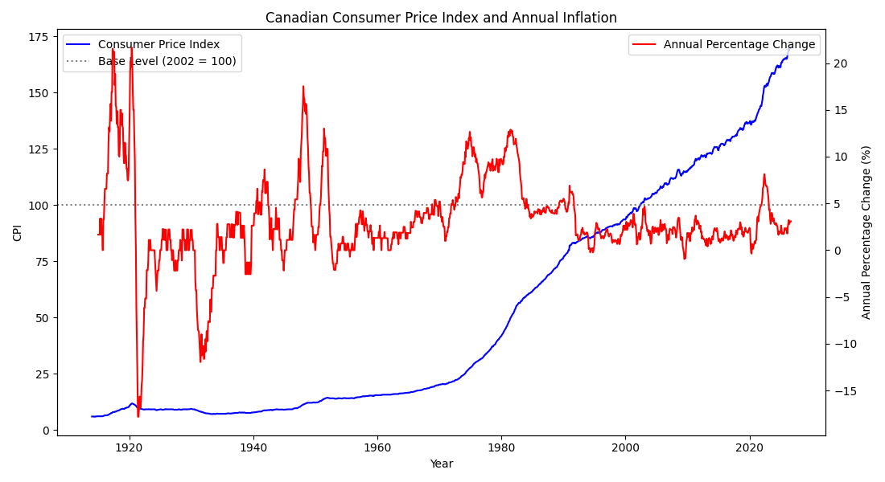

# FINE 3300 - Assignment #2

## Description

This project uses Python to examine Canada's Consumer Price Index (CPI) and calculate inflation using monthly data from the Bank of Canada. The program creates a graph of historical CPI levels and annual percentage changes, then uses the data to compare prices between two periods.

The inflation calculator builds on the Bank of Canada's original version by allowing users to select a specific month and year instead of just a year.

## Project Files

- **InflationCalculator.py**: Main Python file containing the CPI analysis, graph and inflation calculator.
- **STATIC_INFLATIONCALC.csv**: Monthly CPI dataset downloaded from the Bank of Canada.
- **CPI_Graph.png**: Graph of Canadian CPI levels and annual inflation from 1914 to 2026.
- **README.md**: Project description, instructions and sample results.

## How to Run the Program

1. Download or clone the GitHub repository.
2. Open the project folder in Visual Studio Code using File > Open Folder. Make sure the Python file and CSV dataset are saved in the same folder.
3. Ensure Python is installed and select the appropriate Python interpreter in VS Code.
4. Open Terminal > New Terminal and install the required libraries:

   ```bash
   python -m pip install pandas matplotlib
   ```

5. Open `InflationCalculator.py` and click Run Python File.
6. Enter the original price, followed by the starting and ending years and months. Months should be entered as numbers from 1 to 12.
7. The calculator displays the CPI values for both periods, the equivalent price, percentage change and average annual inflation rate. It also calculates the number of years between the dates.
8. The CPI graph is saved automatically as `CPI_Graph.png` and is displayed after the calculator results.

### Input Validation

The program checks that the price is greater than zero and that both dates are available in the CPI dataset. Invalid entries produce an error message and the user is asked to try again.

The available data covers January 1914 to September 2026.

## CPI Analysis

The CPI measures changes in the price level of a basket of consumer goods and services. Annual percentage changes are calculated by comparing each month's CPI with the value from the same month in the previous year.

The graph uses the left axis for CPI levels and the right axis for annual percentage changes. A dotted horizontal line marks the CPI base level of 100, with 2002 as the reference year.

### CPI Graph



### Graph Observations

The CPI remained relatively low during the first half of the twentieth century before increasing more rapidly from the 1970s onward. By September 2026, the index had reached 170.0, compared with approximately 6.0 in January 1914.

Annual inflation shows a different pattern. While the CPI has generally increased over time, the rate of inflation has fluctuated considerably.

Some notable periods include:

- **1917-1921:** Inflation increased sharply during the First World War period before turning negative in the early 1920s. The graph shows some of the largest annual changes during these years.
- **1930s:** CPI declined during the Great Depression, with annual percentage changes falling below zero. This indicates a period of deflation.
- **1970s and early 1980s:** Inflation remained elevated for several years, reaching double-digit rates at certain points.
- **2021-2022:** Inflation increased again, reaching approximately 8% before declining in the following years.

Although the inflation rate fell after 2022, the CPI continued rising. This shows that a lower inflation rate does not necessarily mean prices are decreasing. Instead, prices may still be increasing at a slower pace.

## Inflation Calculator

The calculator uses CPI values from two selected months to estimate how the cost of goods and services has changed.

The equivalent price is calculated using:

**Equivalent Price = Original Price × (Second CPI / First CPI)**

The percentage change is calculated as:

**Percentage Change = ((Second CPI / First CPI) - 1) × 100**

The program also calculates the average annual inflation rate using the time between the two selected periods.

## Sample Output

The following example compares the cost of $100 in September 2025 with September 2026.

### User Input

```text
Enter the original price ($): 100
Enter the first year: 2025
Enter the first month (1-12): 9
Enter the second year: 2026
Enter the second month (1-12): 9
```

### Calculator Output

```text
Original Price: $100.00 CAD
First Date: 2025 9
Second Date: 2026 9
CPI for the first date: 164.9
CPI for the second date: 170.0
Equivalent Price: $103.09 CAD
Percentage Change: 3.09%
Number of Years: 1.00
Average Annual Inflation Rate: 3.09%
```

Based on the CPI values, goods costing $100 in September 2025 would cost approximately $103.09 in September 2026. This represents a price increase of 3.09% over one year.


## Data Source

Bank of Canada: https://www.bankofcanada.ca/valet/observations/STATIC_INFLATIONCALC/csv

